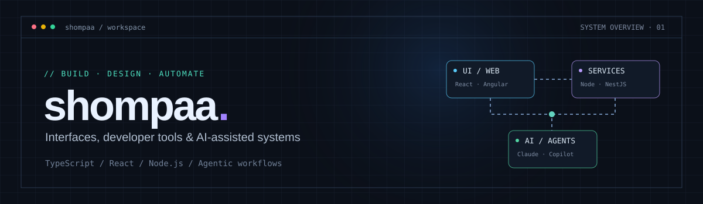
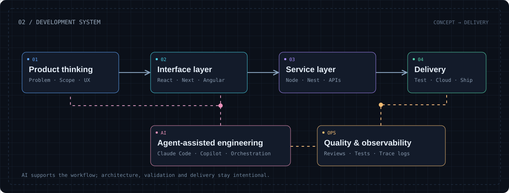

  

 

  
  

### `01 / WHAT I BUILD`

Building **web experiences, backend services, internal developer tools, and AI-assisted engineering workflows** — with an emphasis on usable interfaces, clear architecture, and practical automation.

| `INTERFACES` | `SYSTEMS & APIs` | `AI & AUTOMATION` |
| :--- | :--- | :--- |
| Responsive dashboards, UI systems, component-driven applications | Node.js services, APIs, integrations and developer platforms | Agent orchestration, coding assistants, workflow automation and repo-aware tools |
| React · Next.js · Angular · Ionic · Astro | NestJS · Express · Kong · MongoDB · MySQL | Claude Code · GitHub Copilot · AI agents |

### `02 / HOW I BUILD`

  

AI is part of the development workflow, not a replacement for design decisions, code review, or validation.

### `03 / TOOLKIT`

**Languages & interface development**

**Backend, data & API platforms**

**Cloud, tooling & quality**

**AI-assisted engineering**

### `04 / SELECTED WORK`

| Project / Focus | What it explores |
| :--- | :--- |
| **[Japanese Study App](https://shompaa.github.io/japanese-n5/)** | Interactive Japanese-learning tools, practice and structured study experiences |
| **AI Developer Orchestration** | Planning, delegation, repository context, traceability and assisted code review |
| **AutoReel Studio** | Local-first video editing workflows, timeline UI and AI-assisted event detection |
| **API Explorer & Developer Dashboards** | Service discovery, API documentation, architecture diagrams and internal tooling |

Some work is private or experimental; descriptions reflect areas of work rather than public repository links.

### `05 / CONTRIBUTION ACTIVITY`

  

Live activity graph powered by a third-party renderer. GitHub also displays its native contribution calendar on the profile page.

---

  BUILD THOUGHTFULLY · DESIGN CLEARLY · AUTOMATE WHAT MATTERS

